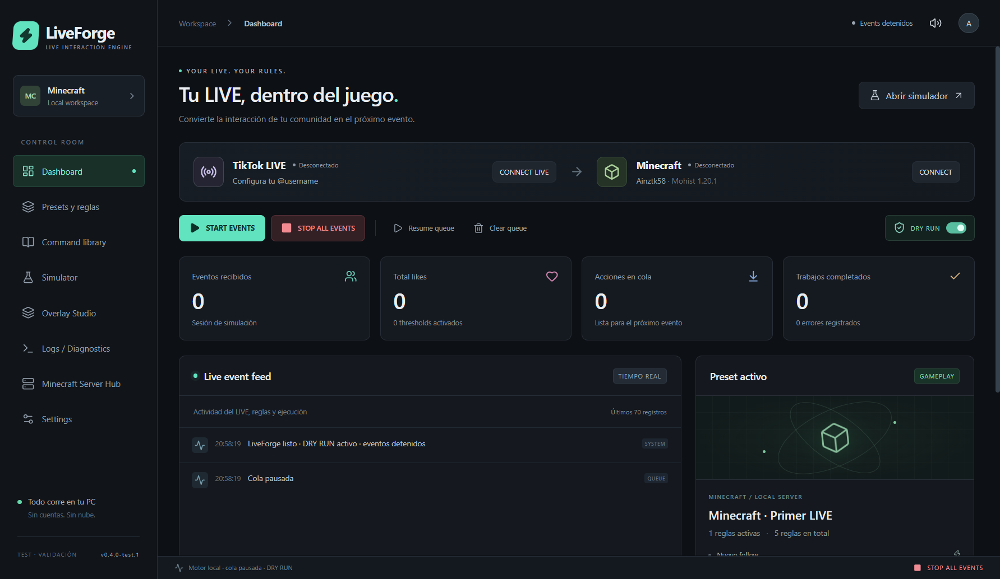

# LiveForge

Aplicación de escritorio para Windows que convierte eventos de un livestream en acciones de videojuegos. Incluye integración TikTok, simulador local, motor de reglas, cola serial y adaptador Minecraft/RCON, además de alertas, audio y Overlay Studio para OBS.



## Versión de esta fuente

Este repositorio conserva la fuente más reciente localizada: **0.4.0-test.1**, con Overlay Studio, Browser Source y reservas estimadas de rendimiento. Las copias de desarrollo de C: y E: coincidieron en los 124 archivos seleccionados el 16/11/2026.

`package.json` y el nombre de algunos componentes conservan **0.2.0** por una decisión histórica de empaquetado documentada. No se modifican para inventar una nueva release. Al compilar con los scripts estándar, el número de paquete continúa siendo 0.2.0; el Portable histórico 0.4.0-test.1 usó un override independiente. Consulta [la validación v0.4](docs/validation-v0.4.md).

## Funciones incluidas

- Eventos TikTok normalizados: chat/comandos, likes, regalos y rachas, follow, share y suscripción según disponibilidad del proveedor.
- Presets y reglas editables: condiciones, cooldown, prioridades, delays, repeticiones, intervalos, pools y políticas de error.
- Cola de acciones, START/STOP, pausa y **DRY RUN**; los comandos Minecraft no se envían mientras el trabajo está protegido como simulación.
- Adaptador Minecraft Java por RCON local, biblioteca de comandos y Server Hub.
- Simulador de eventos, logs, diagnósticos y persistencia SQLite con migraciones.
- Alertas y reproducción de archivos de audio elegidos por el usuario.
- Overlay Studio y servidor HTTP de loopback para HUD/alertas en una fuente de navegador.
- Reservas estimadas de rendimiento y borradores de preset Bedrock. Las reservas no miden TPS ni eliminan efectos del juego.

## Requisitos e instalación desde código

Para desarrollo: **Node.js 24 o superior y npm**. Windows x64 es el destino de la aplicación de escritorio y de su empaquetado. La API SQLite usada por Node puede mostrar un aviso experimental.

```powershell
git clone https://github.com/brusmakaka-lab/liveforge.git
cd liveforge
npm ci
npm run dev
```

La instalación de Electron puede necesitar Internet. Mantén `package-lock.json`: `npm ci` instala las versiones resueltas en ese lockfile. No se incluyen dependencias instaladas, instaladores ni builds generados en este repositorio.

Para compilar y revisar:

```powershell
npm run typecheck
npm run lint
npm test
npm run build
```

`npm run check` reúne esos cuatro controles. `npm run test:e2e` compila y ejecuta las pruebas de Electron con fixtures locales. `npm run pack:win` genera un directorio Windows y `npm run dist:win` añade instalador/portable después de los controles. Los ejecutables históricos citados en documentos anteriores no están adjuntos a este repositorio.

## Configuración y uso

1. La aplicación abre con eventos detenidos y DRY RUN activo.
2. En Settings, configura tu nombre de TikTok, jugador y conexión RCON local. TikTok puede requerir una clave opcional del servicio de firma; no se incluyen claves.
3. Activa un preset y prepara reglas y acciones. Ensaya en Simulator con DRY RUN activo.
4. Conecta tu LIVE e inicia eventos cuando estés listo. Desactiva DRY RUN únicamente cuando quieras enviar los comandos configurados a tu servidor.
5. STOP cancela lo pendiente; no revierte cambios ya realizados en el mundo.

Minecraft Java necesita RCON habilitado y los mods/plugins que utilicen tus comandos. No se distribuyen Minecraft, mods, mundos ni bibliotecas personales de audio. Los placeholders de comandos que dependían de plugins siguen siendo borradores explícitos.

## Datos y recuperación

El perfil normal se guarda en `%APPDATA%/LiveForge`. `LIVEFORGE_DATA_DIR` permite usar un perfil separado para desarrollo o pruebas. La base SQLite contiene configuración, reglas, presets y logs. Los secretos cifrados con Electron safeStorage pertenecen al usuario de Windows y deben configurarse de nuevo al cambiar de equipo.

Este es un respaldo del **código**, no del perfil personal: no incluye bases, cookies, credenciales, sesiones, audios personales ni mundos. Para conservar tu configuración, cierra LiveForge y guarda el perfil y sus medios en un respaldo privado. Consulta [portabilidad y datos](docs/windows-portability.md).

Para recuperar el programa en otra carpeta/equipo: clona este repositorio, ejecuta `npm ci`, realiza los controles y abre `npm run dev` o genera tu paquete Windows. Configura de nuevo las claves y rutas locales.

## Estado y límites

La comprobación de publicación se registra en [VALIDACION-GITHUB.md](VALIDACION-GITHUB.md). Las pruebas históricas de otras fechas se conservan en `docs/`; no equivalen a una nueva prueba de TikTok, Minecraft real, OBS o audio humano.

La conexión TikTok usa un conector no oficial y depende de servicios externos. Browser Source y captura OBS/TikTok Live Studio conservan validación manual pendiente según el alcance histórico. No se garantiza compatibilidad de cada mod ni se envían comandos a un servidor real durante las pruebas de publicación.

## Arquitectura y documentación

```text
LiveProvider -> Normalizer -> EventBus -> RulesEngine -> ActionQueue
                                                        |
                                                Action handlers
                                                        |
                                               GameAdapter -> RCON
```

- [Arquitectura](docs/architecture.md), [eventos](docs/event-model.md) y [reglas](docs/rules-engine.md).
- [Minecraft/RCON](docs/minecraft-adapter.md), [TikTok](docs/tiktok-connection.md) y [Server Hub](docs/audit-server-hub.md).
- [Overlay Studio v0.4](docs/overlay-studio-v0.4.md) y [alertas/audio v0.2](docs/v0.2-alerts-audio.md).
- [Validación histórica](docs/validation.md), [validación v0.4](docs/validation-v0.4.md) y [README histórico](docs/README-historico.md).
- [Dependencias de terceros](THIRD_PARTY_NOTICES.md). Se conserva `UNLICENSED` del proyecto original.
