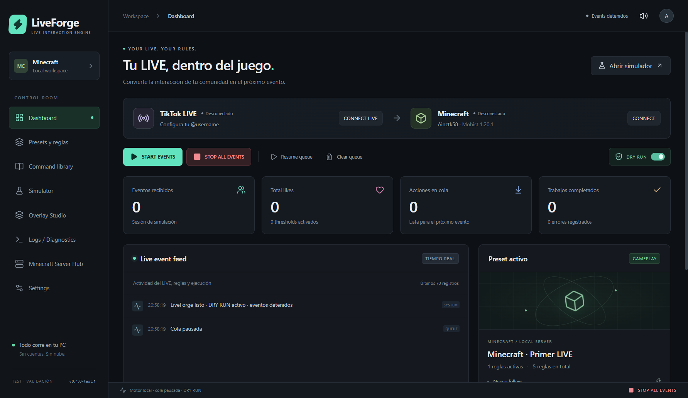

# LiveForge

**v0.4 TEST:** [Overlay Studio, Browser Source y reservas estimadas](overlay-studio-v0.4.md) · [Diseño aprobado](design-v0.4.md) · [Validación y alcance](validation-v0.4.md). No sustituye releases anteriores. La captura en OBS/TikTok Live Studio está pendiente de validación manual.

Motor local para Windows que convierte interacciones de un livestream en acciones de videojuegos. Minecraft es el primer adaptador. Proyecto personal con arquitectura e interfaz originales; no incorpora código, assets ni ingeniería de productos comerciales de referencia.

**Estado:** MVP validado manualmente por el usuario en UI, reglas, simulador, cola, START/STOP, DRY RUN y comandos reales en Mohist/RCON. La versión 0.1.1 corrige la resolución TikTok con usernames en mayúsculas y amplía su diagnóstico. Ver [evidencia y alcance de la validación TikTok](tiktok-connection.md).



## Instalar y abrir en Windows

1. Ejecuta `release/LiveForge-Setup-0.1.1-x64.exe`. El asistente permite elegir carpeta e instala para el usuario actual.
2. Abre **LiveForge** desde su acceso directo. No hace falta Node.js para usar el build.
3. La aplicación inicia siempre con **DRY RUN activo** y **eventos detenidos**. No reconecta ni reproduce trabajos antiguos al abrir.

Alternativa sin instalación: ejecuta `release/LiveForge-Portable-0.1.1-x64.exe`. Ese archivo es autónomo y extrae temporalmente la aplicación al abrir. Ambos formatos usan el mismo perfil `%APPDATA%\LiveForge`; el portable no guarda automáticamente los datos junto al exe. No requieren permisos de administrador para el uso normal.

Los ejecutables no tienen certificado de firma comercial. Windows puede mostrar «Editor desconocido». También se genera `release/win-unpacked/`, con la aplicación empaquetada completa: no copies sólo su `LiveForge.exe` sin los archivos acompañantes. Ver [traslado a otra PC y copias de seguridad](windows-portability.md).

Requisitos: Windows 10/11 x64, acceso a Internet para TikTok, servidor Minecraft Java local con RCON habilitado y comandos/mods disponibles. Referencia del proyecto: Minecraft 1.20.1, Mohist, Forge 47.3.5, jugador inicial `Ainztk58`. No se incluye Minecraft ni ningún mod.

## Primer recorrido

1. En **Settings**, configura tu TikTok username y el nombre del jugador.
2. Configura RCON y pulsa **Guardar y probar conexión**. La prueba envía `list` y muestra la latencia y respuesta.
3. En **Presets y reglas**, crea o duplica un preset y actívalo. Cambiar el preset detiene los eventos; pulsa START cuando estés preparado.
4. Crea una regla. Elige Gift, Follow, Share, Subscribe, Chat command, likes por lote o umbral de likes totales.
5. Añade una o varias acciones. Los comandos admiten delay, repeticiones e intervalo. También hay Wait, audio local, alertas, logs y pools ponderados.
6. Guarda. En Dashboard pulsa **START EVENTS**. Mantén **DRY RUN** mientras ensayas.
7. **TEST** guarda y envía un evento simulado dirigido a esa regla, a través del bus, motor y cola. Ejecuta sus acciones aun si está deshabilitada, sin aplicar filtros/cooldown ni alterar contadores de sesión. STOP sigue bloqueándolo. Para probar las condiciones reales utiliza **Simulator**.
8. En Simulator prueba, por ejemplo, Rose ×5. El feed muestra el evento, coincidencia, trabajo y comando renderizado. El simulador sí modifica los contadores de sesión.
9. Cuando haya un LIVE activo pulsa **CONNECT LIVE**, después **START EVENTS**. Una conexión manual inicia una sesión nueva. Una reconexión automática conserva la sesión y sus thresholds.
10. Desactiva DRY RUN para enviar comandos reales. **STOP ALL EVENTS** permanece accesible en todas las pantallas.

## Minecraft y RCON

En el `server.properties` de tu servidor configura:

```properties
enable-rcon=true
rcon.port=25575
rcon.password=ELIGE_UNA_CONTRASENA_LOCAL_LARGA
broadcast-rcon-to-ops=false
```

Reinicia el servidor después de cambiarlo. LiveForge se conecta a `127.0.0.1`, `localhost` o `::1`; no admite un host público en este MVP. Mantén el puerto RCON bloqueado desde otras máquinas mediante el firewall y no lo reenvíes desde el router. El protocolo RCON no cifra el tráfico. La contraseña local se cifra en disco con Electron safeStorage/Windows DPAPI.

Los comandos RCON corren como consola. Para ejecutarlos en la posición del jugador usa:

```text
execute as {{player}} at @s run weather2 summon tornado_f1
execute as {{player}} at @s run weather2 summon firenado_f1
execute as {{player}} at @s run weather2 summon sharknado
weather2 kill_all_storms
```

No hay una lista cerrada de comandos. Se acepta una línea libre, se elimina una barra inicial opcional y se rechazan saltos de línea y NUL. El servidor decide si el comando existe. Una respuesta RCON recibida significa que se entregó el comando, no que el mod produjo el efecto deseado: revisa la respuesta del servidor en Logs.

Si Minecraft se cae, usa CONNECT o la prueba de Settings para reconectar sin reiniciar LiveForge. Los comandos que fallan o agotan su timeout **no se reenvían automáticamente**, porque podrían haberse ejecutado antes de perder la respuesta.

## TikTok provider

`tiktok-live-connector` 2.5.0 queda encapsulado en `src/providers/`. Se usan las APIs y los tipos de la versión instalada; `processInitialData:false` descarta el historial inicial. El proveedor elimina el `@`, espacios exteriores y convierte el username a minúsculas antes de resolver el Room ID. Esto también se aplica a la configuración existente sin migrar ni borrar datos.

Los errores TikTok conservan `message`, `stack`, `cause`, el envoltorio `info/exception`, fuentes de resolución y códigos HTTP en Diagnostics. Se excluyen headers/configuraciones de petición, cookies y parámetros de URLs firmadas. Los fallos de las fuentes se muestran como texto legible en Logs, en lugar de `[object Object]`.

Es una integración **no oficial**, dependiente de cambios de TikTok y del servicio externo de firma Euler Stream. No requiere introducir contraseña ni cookies de TikTok. Settings permite una signing API key opcional, cifrada, si ese servicio la exige. La disponibilidad, restricciones y eventuales condiciones de ese servicio no están controladas por LiveForge. No se crean cuentas ni se contratan servicios automáticamente.

Reconexión: 2, 4, 8, 16, 32 y hasta 60 segundos entre intentos, con estado RECONNECTING. Cambiar credenciales invalida el cliente de firma almacenado en caché. Las conexiones antiguas no pueden publicar eventos; eventos con timestamp anterior al intento se descartan con tolerancia de 2 segundos. La deduplicación persiste durante una reconexión.

Subscribe se normaliza desde `SUB_NOTIFY` para estados activos ONCE/CIRCLE. No se trata la entrada de un Super Fan existente como una nueva suscripción. Este mapping necesita confirmación con eventos reales de la cuenta; su disponibilidad depende de TikTok.

## Reglas, sesiones y seguridad

- **Rachas:** EACH_GIFT emite un trabajo por cada incremento de cantidad; STREAK_END emite un trabajo con la cantidad final. Regalos no acumulables se procesan inmediatamente. Cooldown y capacidad pueden descartar trabajos según la política elegida.
- **Umbrales:** cada `ruleId:amount` dispara una vez por sesión. Al llegar a 50.001 no se repiten umbrales ya disparados. Reset limpia esos marcadores y toma como referencia el último total remoto; evita volver a dispararlos por un total histórico.
- **Cooldown:** IGNORE descarta durante la reserva; QUEUE agenda turnos separados; REPLACE cancela los pendientes de esa regla y conserva el primer turno disponible. No interrumpe un comando enviado.
- **Prioridades:** CRITICAL, HIGH, NORMAL, LOW, con orden de llegada a igualdad de prioridad. Una secuencia activa no se interrumpe para adelantar otra.
- **Pausa:** deja entrar nuevos trabajos y detiene el avance entre pasos. Los temporizadores que ya empezaron siguen transcurriendo. Clear cancela sólo pendientes.
- **STOP:** bloquea triggers y TEST, pausa la cola, cancela pendientes y espera/secuencia restante del trabajo activo. Un comando RCON ya enviado puede terminar. No revierte cambios del mundo ni ejecuta comandos de limpieza implícitos.
- **DRY RUN:** no envía MinecraftCommand, pero ejecuta sonidos, alertas, esperas y logs. Un trabajo encolado en dry run conserva esa protección aunque luego se desactive el modo.
- **Errores:** STOP_JOB detiene la secuencia que falla; CONTINUE sigue sus siguientes pasos y deja el trabajo FAILED. La cola sigue con otros trabajos. Audio fallido sólo produce advertencia.
- **Variables:** `player`, `username`, `nickname`, `giftName`, `giftCount`, `likeCount`, `totalLikes`. En comandos, valores externos se convierten en un único token sin selectores, espacios, comillas, barras ni delimitadores. No se ofrece una variable con el texto raw del chat.
- **Límites operativos:** 500 pendientes + un trabajo activo, 100 trabajos terminados, 500 registros en UI, 10.000 logs persistidos, 20 raws opcionales de hasta 16 KiB. Límites de pasos/repeticiones protegen de ráfagas; no hay límite de cantidad de reglas o presets.

## Preset inicial editable

`Minecraft · Primer LIVE` contiene:

| Regla                  | Estado inicial | Configuración                                                               |
| ---------------------- | -------------- | --------------------------------------------------------------------------- |
| A: Follow → Meteorito  | Desactivada    | Reemplazar el LogMessage por el comando real de Skyfall.                    |
| B: Rose → Tornado F1   | Habilitada     | Weather2 con `{{player}}`, fin de racha, cooldown de 30 s.                  |
| C: Gift → Fire Tornado | Desactivada    | Elegir regalo/ID; comando Weather2 aportado.                                |
| D: 50K likes → Boss    | Desactivada    | Reemplazar logs por spawn/remove; Wait de 60 s entre ambos.                 |
| E: Gift → Boom         | Desactivada    | Elegir regalo y completar `/boom` con la sintaxis de potencia de tu plugin. |

No se inventan los comandos de meteorito, boss o potencia de boom. La biblioteca contiene estos borradores, Weather2 y ejemplos vanilla.

## Datos y copias de seguridad

SQLite reside en `%APPDATA%\LiveForge\liveforge.sqlite` junto con WAL/SHM mientras está abierta. Cierra la aplicación antes de copiar los datos. Incluye presets, reglas/acciones, settings, comandos y logs. No almacena la cola para evitar ejecuciones inesperadas al reiniciar. Los secretos cifrados son propios del usuario de Windows y deben configurarse nuevamente en otra PC; los audios se copian por separado. [Instrucciones completas](windows-portability.md).

Retención de logs: 7 días por defecto, configurable de 1 a 30; limpieza al iniciar y cada minuto, máximo de 10.000 entradas después de cada limpieza. Raw sólo en memoria si se habilita. Copy diagnostics incluye usernames, comandos, estado y raws opcionales; oculta secretos conocidos. No existe telemetría comercial ni sincronización cloud.

## Desarrollo

Requisitos de desarrollo: Node.js 24 o superior, npm, Windows x64 para el build Windows. SQLite de Node aún marca su API como experimental; Electron está fijado y verificado con la versión usada por este proyecto.

```powershell
npm ci
npm run dev
```

Comprobaciones:

```powershell
npm run typecheck
npm run lint
npm test
npm run test:e2e
npm run check
```

Tests E2E inician Electron y un servidor TCP/RCON de prueba en loopback. No conectan con TikTok ni con tu Minecraft. Los perfiles de prueba se guardan en `work/`, separados de tus datos. `LIVEFORGE_DATA_DIR` permite seleccionar un directorio de datos para desarrollo/pruebas.

Build y prueba del paquete:

```powershell
npm run dist:win
npm run test:packaged
```

`dist:win` exige typecheck, lint y tests correctos antes de compilar y generar el instalador y el portable x64. `test:packaged` prueba `release/win-unpacked/LiveForge.exe` con el mismo código que entra en ambos. `npm run pack:win` genera solamente el directorio empaquetado. Las descargas de Electron/NSIS necesitan Internet durante el primer build. No hay actualizador automático.

## Arquitectura y documentos

```text
LiveProvider → Normalizer → EventBus → RulesEngine → ActionQueue
                                                     ↓
                                            ActionHandler registry
                                                     ↓
                                          GameAdapter → Transport
```

El renderer React sólo administra y observa mediante IPC validado. La conexión a TikTok nunca importa Minecraft. El RulesEngine no importa RCON ni Electron.

- [Arquitectura](architecture.md)
- [Modelo de eventos](event-model.md)
- [Motor y scheduler](rules-engine.md)
- [Adaptador Minecraft](minecraft-adapter.md)
- [Estado de validación y definición de terminado](validation.md)
- [Plan técnico](plan.md)
- [Dependencias y licencias](THIRD_PARTY_NOTICES.md)

## Troubleshooting

| Síntoma                 | Comprobación                                                                                                                                          |
| ----------------------- | ----------------------------------------------------------------------------------------------------------------------------------------------------- |
| TikTok no conecta       | Confirma que el username está en LIVE. Consulta RECONNECTING y Logs. Puede ser un cambio de TikTok, bloqueo de red o requisito del servicio de firma. |
| RCON rechaza conexión   | Verifica enable-rcon, puerto, contraseña, servidor iniciado y reiniciado después del cambio.                                                          |
| «Authentication failed» | Guarda la contraseña correcta; el campo vacío conserva la anterior.                                                                                   |
| Regla no dispara        | Activa su preset y la regla, START EVENTS, Gift ID/nombre, fase de racha, condiciones, cooldown y cola pausada.                                       |
| TEST no afecta al juego | Comprueba DRY RUN; el test respeta el modo seguro.                                                                                                    |
| «Unknown command»       | La entrega RCON funcionó; corrige la sintaxis o instala el mod/plugin. LiveForge no valida una lista de comandos.                                     |
| Jugador no encontrado   | Debe estar conectado y tener el nombre de Settings; consola RCON no tiene posición propia.                                                            |
| Audio no suena          | Revisa mute, volumen, ruta y formato. El máximo por archivo es 20 MB y 12 sonidos simultáneos.                                                        |
| Cola larga              | STOP para cancelar, o Pause para conservar pendientes. Ajusta cooldown, cantidades e intervalos.                                                      |
| Datos no visibles       | Comprueba el usuario Windows y si `LIVEFORGE_DATA_DIR` apunta a un perfil de prueba. No borres tu SQLite.                                             |

Para incidentes usa Logs / Diagnostics → Copy diagnostics. Overlay para OBS, HTTP/WebSocket bridge, otros juegos y proveedores quedan fuera del MVP; existen interfaces de extensión sin una implementación ficticia.

## v0.2: alertas y audio

Ventana vertical transparente independiente, seguimiento visual de rachas, cola de audio, preview y niveles manuales. Guía y límites de captura: [docs/v0.2-alerts-audio.md](v0.2-alerts-audio.md).

Artefactos nuevos: `release/v0.2.0/LiveForge-Setup-0.2.0-x64.exe` y `release/v0.2.0/LiveForge-Portable-0.2.0-x64.exe`. Los ejecutables v0.1.1 se conservan. Para ensayar sin tocar el perfil estable, usa el lanzador aislado incluido junto al Portable; respalda AppData antes de actualizar sobre datos reales.
