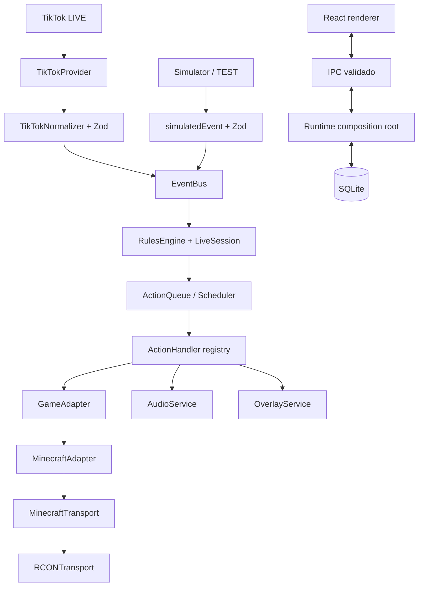

# Arquitectura

## Límites de responsabilidad

| Módulo                           | Responsabilidad                                                 | No conoce                        |
| -------------------------------- | --------------------------------------------------------------- | -------------------------------- |
| `shared/model.ts`                | Contratos TypeScript y esquemas Zod; sin I/O.                   | UI, red, SQLite                  |
| `providers/contracts.ts`         | LiveProvider y entrega de eventos normalizados.                 | Juegos                           |
| `providers/tiktok.ts`            | Conexión, ciclos de vida, backoff y generaciones.               | Reglas/RCON                      |
| `providers/tiktok-normalizer.ts` | Campos del proveedor → modelo interno validado.                 | Acciones                         |
| `providers/simulator.ts`         | Construcción/validación de eventos de prueba.                   | Transporte de juego              |
| `core/events.ts`                 | Bus con aislamiento de listeners; dedup y rachas acotadas.      | Electron                         |
| `core/rules-engine.ts`           | Sesiones, filtros, thresholds, batches y admisión/cooldown.     | TikTok API/RCON/UI               |
| `core/queue.ts`                  | Scheduler serial, prioridad, temporizadores, pausa/cancelación. | Implementación de los handlers   |
| `core/action-handlers.ts`        | Renderizado y servicios inyectados.                             | TikTok                           |
| `adapters/`                      | GameAdapter y MinecraftTransport reemplazables.                 | Reglas/UI                        |
| `storage/`                       | SQLite, migraciones, transacciones y retención.                 | DOM                              |
| `main/`                          | Composición, IPC, secretos, archivos y servicios desktop.       | Renderizado React                |
| `renderer/`                      | Pantallas, formularios, observación y audio.                    | SQLite, Node, secretos guardados |

## Flujo

## Desktop y seguridad

Electron main posee el estado, SQLite y los sockets. El renderer local usa `sandbox:true`, `contextIsolation:true`, `nodeIntegration:false`, CSP y bloqueo de navegación/ventanas externas. Preload expone un único protocolo de mensajes de aplicación tipados y una suscripción de medios. Cada solicitud se valida con una unión cerrada Zod y se verifica que provenga del main frame esperado; no se expone ipcRenderer genérico, filesystem ni shell.

Los secretos se cifran con safeStorage asíncrono/DPAPI y sólo se devuelven flags de existencia. Logs y diagnósticos ocultan nombres de campos sensibles y valores de secretos conocidos. No hay cookies de login de TikTok. Audio se lee desde el main con validación de extensión, tamaño y archivo regular, y se entrega como data URL local.

## Persistencia

SQLite nativo (`node:sqlite`), WAL, claves foráneas, prepared statements, busy timeout. Migraciones ordenadas en `storage/migrations.ts`; la tabla migrations evita reaplicarlas. Tablas settings, secrets, presets, rules, actions, saved_commands y logs. Acciones separadas con orden explícito. Guardar una regla usa savepoint; duplicar un preset usa una transacción exterior.

No se persisten trabajos ni LiveSession: un reinicio es una sesión nueva. Settings conserva el preset activo y no guarda el estado «eventos habilitados». Sólo un preset de gameplay activo. Los ejemplos se insertan únicamente en una base sin presets.

## Extensión

Un nuevo LiveProvider entrega `InternalLiveEvent`; no cambia el motor. Un juego nuevo implementa `GameAdapter<TAction>` e inyecta handlers nuevos. El tipo de acción y su schema se añaden en shared/model y su editor en UI; la cola despacha por registro. Un transporte HTTP/WebSocket futuro sólo implementa MinecraftTransport. ActionPool admite secuencias de acciones hoja para evitar recursión sin límite.

OverlayService está implementado por alertas locales del desktop. Servir una Browser Source/OBS requerirá otro servicio que implemente la misma interfaz; no hay servidor overlay anunciado que no exista.

## Límites conocidos

Procesos y timers son asíncronos para las conexiones/acciones; SQLite usa operaciones síncronas cortas en main. No se afirma escalabilidad ilimitada: colas, cachés, logs y pasos tienen cotas. La vista consulta snapshots cada 600 ms con una sola solicitud periódica en vuelo. El scheduler ejecuta una secuencia completa a la vez y no interrumpe un comando RCON enviado. Los detalles de entrega y pruebas están en validation.md.
